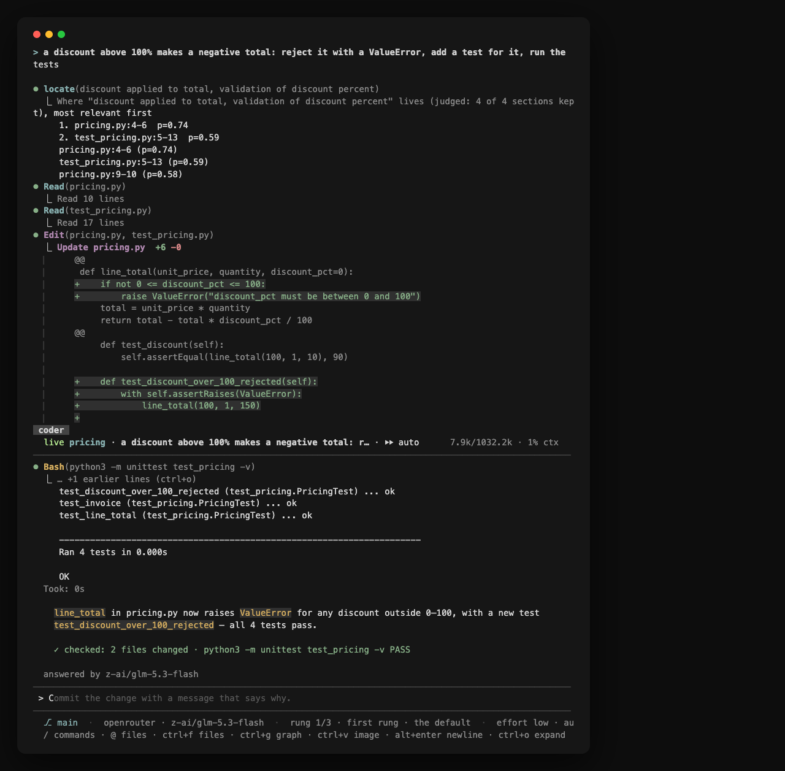

Picture the scene: it is 11 PM on a Friday, your phone buzzes with a GitHub notification — "PR ready for review". The diff has 847 lines across 6 files, and you have exactly 20 minutes before the happy hour you have been waiting for all week. You open the tab, try to make sense of the change, feel the anxiety rising, and close everything. Tomorrow. Probably.

That gap between receiving a diff and understanding enough to decide whether it can land is exactly where coding-agent tools try to work. Memdoor is one of them. What makes it interesting is not the "team of LLMs" label that put it on Hacker News, but the design: a single binary, a decision model in front of the chat model, and workflows versioned in the repository itself.

## What memdoor is, without the hype

Memdoor is an open-source project from October 2026, written in Go and released under Apache 2.0. The official description is blunt: a coding and automation agent in a single CLI binary that runs locally or over SSH on another machine, with no Docker and no Python. Three platforms (macOS, Linux and Windows), one static binary installed into `~/.local/bin`, no sudo, and an installer that checks the SHA-256 of what it downloads.

The central idea is that the same run can be opened through different doors. In the terminal, a TUI. In the editor, over the Agent Client Protocol (ACP): Zed and JetBrains host it natively, and VS Code uses an ACP client extension. On your phone, with `/remote`, which produces a link and a QR code to follow the conversation (end-to-end encrypted) and, if you want, type into it. In scripts, CI and cron, through the headless mode. The run lives on a gateway on your machine, so closing the laptop does not stop the work: the next terminal, editor or phone opens the same conversation.

That gateway also answers to peers. `memdoor peers add box http://box:18789 --dir ~/app` names another machine, and `@box:coder …` in any conversation runs the turn there, on that machine's model, and brings the answer back. It is the difference between "install an agent on every box" and "have one agent that reaches the boxes you already have".

You bring your own model (BYOK). The provider list includes OpenRouter, Anthropic, OpenAI, Gemini, DeepSeek, Baseten, Groq, xAI, any OpenAI-compatible endpoint and your company's AI gateway. You can also run with no key at all: `/connect local` finds a model on the machine itself (Ollama, llama.cpp or janis, the same author's open-model server), and `/connect chatgpt` signs in with a ChatGPT Plus or Pro plan. A Claude subscription cannot be used this way under Anthropic's terms; that case needs an API key.

<figure>
    
    <figcaption>The memdoor logo. Official image from the guregodevo/memdoor repository, released under Apache 2.0.</figcaption>
</figure>

## A decision model before the chat model

Most agents send everything to the chat model and let it decide what matters. Memdoor adds a step first: Jev, a decision model from TypeSafe, answers typed questions — "is this passage relevant to the task?" — with a calibrated probability in under half a second. The harness acts on that answer: search, file and log reads return only what counts; only the tools the turn needs are sent; and a turn that stops making progress ends instead of looping to a cap.

The number the project publishes is measured, not estimated: over 44 paired runs, with decisions off and on, 22 of 22 passed each way. A question about the codebase went from 54,661 to 14,367 input tokens (−74%). In an edit with a test and in ten one-file fixes, both modes read the same files, within ±11%. The decisions documentation (`docs/features/DECIDE.md`) has the detail.

It is worth being clear about what this is not: Jev is not a "fifth agent" with an opinion on the code. It is a filter that decides what enters the context. The part that solves the problem is still the chat model you connected.

## Workflows are files in the repository

The second idea is to treat multi-step work as a file, not a conversation. You describe the steps, and the agent itself writes each one as a YAML file in `.memdoor/workflows/<name>/`, run as a graph by mario (the same author's task engine). Independent steps run in parallel. A step is done when its check passes — never because the model said so. A gate waits for your approval with the diff in front of you. And a failed run resumes at the failed step.

Because the files live in the repository, the workflow is versioned, shared and runnable again, by hand or on a local cron. There are ready-made examples in `examples/workflows/` and a written argument for preferring workflows over "skills" on the author's blog.

A real graph, from `team-solve`:

```text
plan ──┬── ideate-a ──┬── solve ── test ── review ── repair ── verify
       └── ideate-b ──┘
```

Each node is one YAML file. The two ideators run in parallel and write independent proposals; `test` never fails the run by itself, and `verify` has the final word. Success is decided by a script comparing output against the samples, not by a model saying "done".

## One step in GitHub Actions, nine ready workflows

For running memdoor inside GitHub, the integration is an action: `guregodevo/memdoor-action@v1`. It runs on your key and asks for nothing added to the repository beyond the step in the workflow.

```yaml
on: pull_request
jobs:
  review:
    runs-on: ubuntu-latest
    steps:
      - uses: actions/checkout@v5
      - uses: guregodevo/memdoor-action@v1
        with:
          workflow: pr-review
          openrouter-api-key: ${{ secrets.OPEN_ROUTER_API_KEY }}
```

With no key, the `local-model: Qwen3-8B-4bit` input swaps the key for a model inside the runner (through janis, with the model cached), in a single call. The README is honest about the result: it is a free first pass, not a reviewer — on a free runner it caught an obvious and a subtle bug in about a minute each, and it can also file the fix for a correct change as a blocker.

Nine workflows ship built in:

- `pr-triage` sorts a pull request for a maintainer: ready for review, needs work, or likely slop, from checks run in the job (the tests, claimed tests that are not there, functions nothing calls).
- `pr-review` reviews the pull request, verifies each finding by running the code, and fails the job only on a blocker.
- `security-review` does the same for security only: secrets, injection, path traversal, missing authorization.
- `write-tests` writes tests for what the change touches and fails the job when one shows the change is wrong.
- `pr-description` writes the description: title, What, Why, How to test, Risk.
- `explain-failure` reads a failed run's logs and the diff: the cause, file:line, and the fix.
- `issue-triage` suggests labels, the kind, a summary and duplicates for a new issue.
- `fix-tests` finds the test command, fixes the code until the tests pass, and leaves the fix in the working tree.
- `release-notes` turns the commits since the last tag into Added / Changed / Fixed.

For your own, `workflow: <name>` points at `.memdoor/workflows/<name>/` in the repository.

One security detail worth repeating: trigger on `pull_request`, never `pull_request_target`. GitHub gives a fork's pull request no secrets, so a stranger's code never runs beside your key. The job ends with the run's outcome in the exit code: 0 done, 2 failed, 1 stopped, 3 stopped at an approval gate. The job summary shows the review, the fix or the notes.

## The five-Qwen3.8-27B team and the LiveCodeBench Hard test

The thread that introduced the project to Hacker News had a loud title: "Memdoor: A team of 5 Qwen3.8-27B models beats Fable 5 on LiveCodeBench Hard". At the time of writing it had 295 points and 138 comments. The title is true, but it describes one specific example, not the product architecture — which is where a lot of people get confused.

The example is the `team-solve` workflow. Five small models solve a programming problem together: a planner, two ideators, a solver and a manager, plus a repair worker. Each starts from a fresh context and talks only through files on disk. A script that runs the samples decides success, not a model. It is the method of GVS5H (Lee, 2026), written as a memdoor workflow: eight YAML files, no code and no model named.

The published result, on the first ten problems of the paper's LiveCodeBench Hard list, five passes each, graded on every hidden test:

| pass | this workflow | authors' harness | Fable 5, one call |
|---|---|---|---|
| 1 | **10** / 10 | 9 | 7 |
| 2 | **10** / 10 | 10 | 8 |
| 3 | **10** / 10 | 10 | 10 |
| 4 | **10** / 10 | 9 | 8 |
| 5 | **9** / 10 | 10 | 7 |
| mean | **9.8** | 9.6 | 8.0 |

What the result does and does not show — the repository lists the caveats itself. It is ten problems and five passes, not the paper's 100; on a sample that small, 9.8 and 9.6 are the same number, and the claim is parity with the authors' harness, not a gain on it. The contests date from spring 2025, and training contamination cannot be ruled out for any column. The Fable 5 column comes from the authors' files and was not run in this harness. The model ran on OpenRouter, not on a local machine. The loop sees only the public samples; the score is the hidden tests.

The cost details are published too: a run took a median of 40 minutes and $0.39; the 50 runs cost $35.79. And the single lost problem has an instructive cause: the manager invented a wrong counterexample and the team rewrote a correct program. Twice elsewhere a correct program was overwritten and then recovered. Both gaps are the authors' loop, kept as is.

## Installing and actually running it

The install is that of any single binary:

```bash
curl -fsSL https://memdoor.ai/install.sh | bash
export OPENROUTER_API_KEY=sk-or-...
cd your-project && memdoor
```

The first `memdoor` in a project directory sets the machine up. With no key, `memdoor connect local` looks for a model running on the machine; with Ollama, remember that the default context window is 4K and the README asks for 32K for this use.

To build from source you need Go 1.25 and `make`:

```bash
git clone https://github.com/guregodevo/memdoor && cd memdoor
make build
cp memdoor ~/.local/bin/
```

Beyond the TUI, the headless mode is what matters for scripts:

```bash
memdoor run "fix the failing test"
git diff | memdoor run "review this diff; one line per finding"
memdoor run --json "fix the failing test" | jq 'select(.event=="done")'
memdoor workflow run release --wait
memdoor resume --last
```

The exit code is the turn's receipt: 0 checked, 2 unverified or a failing check, 3 a question nobody answered (`--yes` answers it), 1 an error, 130 interrupted.

To run it on another box with nothing installed there:

```bash
memdoor --gateway ssh://you@box
memdoor --gateway ssh://you@box connect openrouter
memdoor --gateway ssh://you@box run "fix the failing test"
```

And to use it in your editor:

```json
"acp.agents": { "Memdoor": { "command": "memdoor", "args": ["acp"] } }
```

Inside the window, the commands you will use most: `/model` picks the model (the agent's ladder, cheapest first, or a pinned model with list prices), `/connect` adds a provider, `/workflow` lists and opens runs, `/usage` shows the month on your key and what the decision model kept off the bill, `/remote` and `/remote view` open the conversation on your phone (the second is watch-only, up to 200 people), `/share` produces a read-only link with secrets removed, `/files` and `/graph` show files and the turn as a graph, `/mcp` connects MCP servers.

<figure>
    
    <figcaption>The memdoor window: the task typed, the files read and patched, the tests run, and the receipt line at the end. Screenshot from the official repository, under Apache 2.0.</figcaption>
</figure>

## Where your data goes

What leaves the machine is easy to summarize: files, sessions and commands stay put; what the model reads goes to the provider you connected. On OpenRouter, every request carries `data_collection: deny`, and hosts that train on paid inputs are kept out of the model ladders. The exception is a `:free` model — one you pinned or one an account with no credit uses — whose hosts train on what they are sent; the request says so and memdoor tells you when you connect. Use it for a trial, not for private code.

On a vendor key or a company gateway, nothing beyond the listed hosts is contacted: `docs/SECURITY.md` lists every host the binary can name, and a test fails the build if a new one appears. There is also no account, and telemetry is off unless you turn it on. For machines with a stricter policy, `MEMDOOR_APPROVE=changes` asks before every command and write.

## What it is not

After all that, it is worth being explicit about the limits. Memdoor is not a magic five-agent pipeline: it is one agent with a decision model and declarative workflows. It is not local by default: without `connect local`, the code the model reads goes to the provider. It does not replace human review: checks and gates help, but the merge decision is still yours. And the `team-solve` benchmark is not a general quality seal — ten problems, five passes, with the caveats the project itself publishes.

There is also cost and maintenance. Running five agents through an API multiplies calls; running locally needs a model that fits your GPU (janis runs Qwen3-Coder-30B-A3B on a Google L4 at $0.71 an hour). The free local mode is great for experimenting and for code that cannot leave, but it is not the same as a frontier model.

The most interesting part of memdoor may be the framing: instead of selling "AI that programs by itself", it sells a receipt. The turn ends with what was checked, how many files changed and whether the tests passed. In a market full of demos, an exit code is a much more honest way to say what happened.

## Practical takeaways

- Memdoor is a coding agent in one Go binary, Apache 2.0, with a TUI, headless mode, ACP for editors and phone access.
- A decision model (Jev) filters context before the chat model; the project measures −74% tokens on a codebase question.
- Workflows are YAML files versioned in the repository, with checks, gates and resume from the failed step.
- In GitHub Actions, the action ships nine ready workflows and runs on a key or a local model inside the runner.
- The five-Qwen3.8-27B team is an example workflow: parity with the GVS5H harness on LiveCodeBench Hard, on a small sample with published caveats.
- Nothing replaces human review: the value is in cutting the mechanical work and leaving a verifiable receipt.

## Sources

- [Official memdoor repository](https://github.com/guregodevo/memdoor)
- [Getting started documentation](https://memdoor.ai/docs/getting-started)
- [team-solve: the LiveCodeBench Hard result](https://memdoor.ai/docs/team-solve)
- [team-solve workflow in the repository](https://github.com/guregodevo/memdoor/tree/main/examples/workflows/team-solve)
- [Hacker News thread](https://news.ycombinator.com/item?id=50320995)
- [memdoor-action on GitHub](https://github.com/guregodevo/memdoor-action)
- [mario, the workflow engine](https://github.com/guregodevo/mario)
- [janis, the open-model server](https://github.com/guregodevo/janis)
- [GVS5H, the method behind team-solve](https://github.com/slee-persis/GVS5H)
- [How to run on an open-weight model, no key](https://memdoor.ai/docs/open-weight)
- [Headless mode and exit codes](https://memdoor.ai/docs/headless)
- [Editor via Agent Client Protocol](https://memdoor.ai/docs/editor)
- [Security policy and host list](https://github.com/guregodevo/memdoor/blob/main/docs/SECURITY.md)
- [Workflows, not skills](https://guregodevo.github.io/2026/10/06/workflows-not-skills/)
