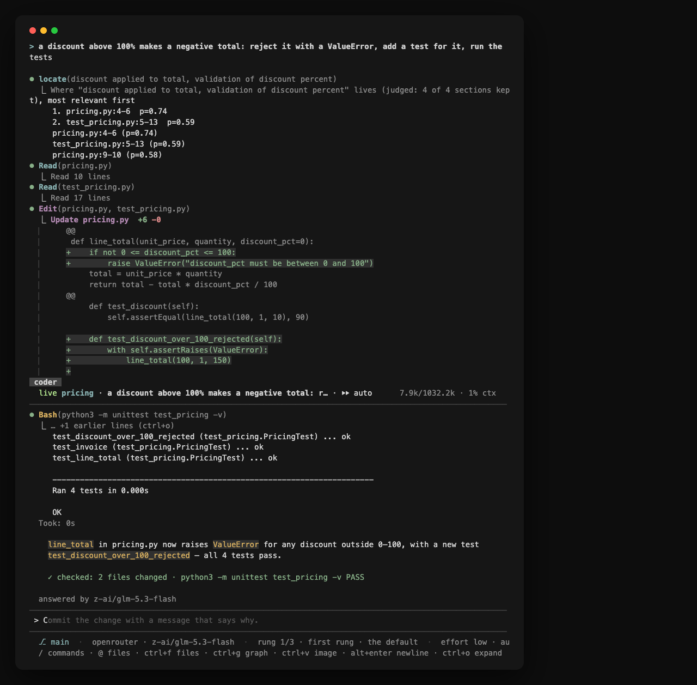

Imagine a cena: são 23h de uma sexta-feira, o celular vibra com uma notificação do GitHub — "PR ready for review". O diff tem 847 linhas, 6 arquivos alterados, e você tem exatamente 20 minutos antes do happy hour que esperou a semana inteira. Você abre a aba, tenta entender o que mudou, sente a ansiedade subir e fecha tudo. Amanhã você olha. Provavelmente.

Esse intervalo entre receber um diff e entender o suficiente para decidir se ele pode entrar é exatamente onde ferramentas de agente de código tentam atuar. O memdoor é uma delas. O que o torna interessante não é o rótulo de "equipe de LLMs" que o colocou no Hacker News, e sim o desenho: um binário só, um modelo de decisão na frente do modelo de chat e workflows versionados no próprio repositório.

## O que é o memdoor, sem o hype

O memdoor é um projeto open-source de outubro de 2026, escrito em Go e distribuído sob Apache 2.0. A descrição oficial é direta: um agente de código e automação em um único binário de CLI, que roda localmente ou conectado por SSH a outra máquina, sem Docker e sem Python. São três plataformas (macOS, Linux e Windows), um binário estático instalado em `~/.local/bin`, sem sudo, e um instalador que confere o SHA-256 do que baixa.

A ideia central é que a mesma execução possa ser aberta por portas diferentes. No terminal, uma interface TUI. No editor, via Agent Client Protocol (ACP): Zed e JetBrains hospedam nativamente, e o VS Code usa uma extensão de cliente ACP. No celular, com `/remote`, que gera um link e um QR code para acompanhar a conversa (criptografada de ponta a ponta) e, se quiser, digitar. Em scripts, CI e cron, com o modo headless. O run fica em um gateway na sua máquina, então fechar o notebook não interrompe o trabalho: o próximo terminal, o editor ou o celular abre a mesma conversa.

Esse gateway também responde a *peers*. `memdoor peers add box http://box:18789 --dir ~/app` nomeia outra máquina, e `@box:coder …` em qualquer conversa roda o turno lá, no modelo daquela máquina, e traz a resposta de volta. É a diferença entre "instalar um agente em cada máquina" e "ter um agente que alcança as máquinas que você já tem".

O modelo é trazido por você (BYOK). A lista de provedores inclui OpenRouter, Anthropic, OpenAI, Gemini, DeepSeek, Baseten, Groq, xAI, qualquer endpoint compatível com a API da OpenAI e o gateway de IA da sua empresa. Também dá para rodar sem chave nenhuma: `/connect local` encontra um modelo na própria máquina (Ollama, llama.cpp ou o janis, o servidor de modelos abertos do mesmo autor), e `/connect chatgpt` entra com uma assinatura ChatGPT Plus ou Pro. Assinatura Claude não pode ser usada assim pelos termos da Anthropic; nesse caso, é chave de API.

<figure>
    
    <figcaption>Logotipo do memdoor. Imagem oficial do repositório guregodevo/memdoor, distribuído sob Apache 2.0.</figcaption>
</figure>

## Um modelo de decisão antes do modelo de chat

A maioria dos agentes manda tudo para o modelo de chat e deixa que ele decida o que importa. O memdoor insere uma etapa antes: o Jev, um modelo de decisão da TypeSafe, responde perguntas tipadas — "este trecho é relevante para a tarefa?" — com uma probabilidade calibrada em menos de meio segundo. O harness age sobre essa resposta: buscas, leituras de arquivo e de log retornam só o que conta; só as ferramentas necessárias para o turno são enviadas; e um turno que para de fazer progresso termina em vez de girar até um limite.

O número que o projeto publica é medido, não estimado: em 44 execuções pareadas, com as decisões desligadas e ligadas, 22 de 22 passaram nos dois sentidos. Uma pergunta sobre a base de código caiu de 54.661 para 14.367 tokens de entrada (−74%). Em um edit com teste e em dez correções de um arquivo, os dois modos leram os mesmos arquivos, com variação de ±11%. A documentação de decisões (`docs/features/DECIDE.md`) tem o detalhamento.

Vale notar o que isso não é: o Jev não é um "quinto agente" que opina sobre o código. É um filtro que decide o que entra no contexto. A parte que resolve o problema continua sendo o modelo de chat que você conectou.

## Workflows são arquivos no repositório

A segunda ideia é tratar trabalho multi-etapa como arquivo, não como conversa. Você descreve os passos, e o próprio agente escreve cada um como um YAML em `.memdoor/workflows/<nome>/`, executado como grafo pelo mario (o motor de tarefas do mesmo autor). Passos independentes rodam em paralelo. Um passo só é considerado concluído quando o check dele passa — nunca porque o modelo disse que passou. Um gate espera a sua aprovação com o diff na frente. E um run que falha retoma do passo que falhou.

Como os arquivos ficam no repositório, o workflow é versionado, compartilhado e executável de novo, à mão ou em um cron local. Há exemplos prontos em `examples/workflows/` e uma justificativa escrita para preferir workflows a "skills" no blog do autor.

Um exemplo de grafo real, o `team-solve`:

```text
plan ──┬── ideate-a ──┬── solve ── test ── review ── repair ── verify
       └── ideate-b ──┘
```

Cada nó é um arquivo YAML. Os dois ideadores rodam em paralelo e escrevem propostas independentes; o `test` nunca derruba o run sozinho, quem dá o veredito é o `verify` no final. O sucesso é decidido por um script que compara a saída com os samples, não por um modelo dizendo "pronto".

## Um passo no GitHub Actions, nove workflows prontos

Para quem quer o memdoor dentro do GitHub, a integração é uma action: `guregodevo/memdoor-action@v1`. Ela roda na sua chave e não exige adicionar nada ao repositório além do passo no workflow.

```yaml
on: pull_request
jobs:
  review:
    runs-on: ubuntu-latest
    steps:
      - uses: actions/checkout@v5
      - uses: guregodevo/memdoor-action@v1
        with:
          workflow: pr-review
          openrouter-api-key: ${{ secrets.OPEN_ROUTER_API_KEY }}
```

Sem chave, o input `local-model: Qwen3-8B-4bit` troca a chave por um modelo dentro do runner (via janis, com o modelo em cache), em uma única chamada. O próprio README é honesto sobre o resultado: é um primeiro passe gratuito, não um revisor — em um runner gratuito ele achou um bug óbvio e um sutil em cerca de um minuto cada, e também pode marcar a correção de um código correto como bloqueador.

Nove workflows vêm prontos:

- `pr-triage` classifica um pull request para o mantenedor: pronto para revisão, precisa de trabalho ou provável slop, a partir de checks rodados no job (os testes, testes declarados que não existem, funções que ninguém chama).
- `pr-review` revisa o pull request, verifica cada achado rodando o código e só falha o job em um bloqueador.
- `security-review` faz o mesmo, restrito a segurança: segredos, injeção, path traversal, autorização ausente.
- `write-tests` escreve testes para o que a mudança toca e falha o job quando um deles mostra que a mudança está errada.
- `pr-description` escreve a descrição: título, O quê, Por quê, Como testar, Risco.
- `explain-failure` lê os logs de um run que falhou e o diff: causa, arquivo:linha e a correção.
- `issue-triage` sugere labels, o tipo, um resumo e duplicatas para uma issue nova.
- `fix-tests` encontra o comando de teste, corrige o código até os testes passarem e deixa a correção na árvore de trabalho.
- `release-notes` transforma os commits desde a última tag em Adicionado / Alterado / Corrigido.

Para os seus, `workflow: <nome>` aponta para `.memdoor/workflows/<nome>/` no repositório.

Um detalhe de segurança que vale repetir: o gatilho é `pull_request`, nunca `pull_request_target`. O GitHub não entrega segredos para o pull request de um fork, então código de estranho não roda ao lado da sua chave. O job termina com o resultado do run no exit code: 0 concluído, 2 falhou, 1 parou, 3 parou em um gate de aprovação. O resumo do job mostra a revisão, a correção ou as notas.

## A equipe de cinco Qwen3.8-27B e o teste no LiveCodeBench Hard

A thread que apresentou o projeto ao Hacker News tinha um título chamativo: "Memdoor: A team of 5 Qwen3.8-27B models beats Fable 5 on LiveCodeBench Hard". No momento em que este texto foi escrito, eram 295 pontos e 138 comentários. O título é verdadeiro, mas descreve um exemplo específico, não a arquitetura do produto — e é aí que muita gente se confunde.

O exemplo é o workflow `team-solve`. Cinco modelos pequenos resolvem um problema de programação juntos: um planejador, dois ideadores, um solucionador e um gerente, mais um worker de reparo. Cada um começa com contexto novo e conversa apenas por arquivos em disco. Quem decide o sucesso é um script que roda os samples, não um modelo. O método é o do GVS5H (Lee, 2026), escrito como workflow do memdoor: oito arquivos YAML, sem código e sem nome de modelo.

O resultado publicado, nos primeiros dez problemas da lista LiveCodeBench Hard do artigo, com cinco passadas e nota em todos os testes escondidos:

| passada | este workflow | harness dos autores | Fable 5, uma chamada |
|---|---|---|---|
| 1 | **10** / 10 | 9 | 7 |
| 2 | **10** / 10 | 10 | 8 |
| 3 | **10** / 10 | 10 | 10 |
| 4 | **10** / 10 | 9 | 8 |
| 5 | **9** / 10 | 10 | 7 |
| média | **9,8** | 9,6 | 8,0 |

O que o resultado mostra e o que não mostra — o próprio repositório lista as ressalvas. São dez problemas e cinco passadas, não os 100 do artigo original; nessa amostra, 9,8 e 9,6 são o mesmo número, e a conclusão é paridade com o harness dos autores, não ganho sobre ele. As competições são da primavera de 2025, e contaminação de treino não pode ser descartada em nenhuma das colunas. A coluna do Fable 5 vem dos arquivos dos autores, não foi rodada neste harness. O modelo rodou no OpenRouter, não em uma máquina local. O loop vê apenas os samples públicos; a nota é dos testes escondidos.

Os detalhes de custo também estão publicados: uma execução levou mediana de 40 minutos e US$ 0,39; as 50 execuções custaram US$ 35,79. E o único problema perdido tem uma causa instrutiva: o gerente inventou um contraexemplo errado e a equipe reescreveu um programa que estava correto. Em outros dois casos, um programa correto foi sobrescrito e depois recuperado. As duas falhas são do loop dos autores, mantido como estava.

## Instalando e rodando de verdade

A instalação é a de um binário comum:

```bash
curl -fsSL https://memdoor.ai/install.sh | bash
export OPENROUTER_API_KEY=sk-or-...
cd seu-projeto && memdoor
```

O primeiro `memdoor` no diretório do projeto configura a máquina. Sem chave, `memdoor connect local` procura um modelo rodando ali; com Ollama, vale lembrar que o default de janela de contexto é 4K e o README pede 32K para esse uso.

Para compilar do zero, são precisos Go 1.25 e o `make`:

```bash
git clone https://github.com/guregodevo/memdoor && cd memdoor
make build
cp memdoor ~/.local/bin/
```

Além da TUI, o modo headless é o que interessa para scripts:

```bash
memdoor run "fix the failing test"
git diff | memdoor run "review this diff; one line per finding"
memdoor run --json "fix the failing test" | jq 'select(.event=="done")'
memdoor workflow run release --wait
memdoor resume --last
```

O exit code é o recibo do turno: 0 verificado, 2 não verificado ou check falhando, 3 uma pergunta que ninguém respondeu (`--yes` responde), 1 erro, 130 interrompido.

Para rodar em outra máquina sem instalar nada nela:

```bash
memdoor --gateway ssh://voce@box
memdoor --gateway ssh://voce@box connect openrouter
memdoor --gateway ssh://voce@box run "fix the failing test"
```

E para usar no editor:

```json
"acp.agents": { "Memdoor": { "command": "memdoor", "args": ["acp"] } }
```

Na janela, os comandos que mais aparecem: `/model` escolhe o modelo (a escada do agente, do mais barato para cima, ou um modelo fixo com preços de lista), `/connect` adiciona provedor, `/workflow` lista e abre execuções, `/usage` mostra o mês na sua chave e o que o modelo de decisão manteve fora da conta, `/remote` e `/remote view` abrem a conversa no celular (o segundo só assiste, até 200 pessoas), `/share` gera um link de leitura sem segredos, `/files` e `/graph` mostram arquivos e o grafo do turno, `/mcp` conecta servidores MCP.

<figure>
    
    <figcaption>A janela do memdoor: a tarefa digitada, os arquivos lidos e corrigidos, os testes rodando e a linha de recibo ao final. Captura do repositório oficial, sob Apache 2.0.</figcaption>
</figure>

## Para onde vão seus dados

O que sai da máquina é fácil de resumir: arquivos, sessões e comandos ficam onde estão; o que o modelo lê vai para o provedor que você conectou. No OpenRouter, toda requisição carrega `data_collection: deny`, e hosts que treinam em entradas pagas ficam fora das escadas de modelo. A exceção é um modelo `:free` — o que você fixou ou o que uma conta sem crédito usa —, cujos hosts treinam no que recebem; o request diz isso e o memdoor avisa na hora de conectar. Use para teste, não para código privado.

Em chave de fornecedor ou gateway da empresa, nada além dos hosts listados é contatado: `docs/SECURITY.md` lista cada host que o binário pode nomear, e um teste quebra o build se aparecer um novo. Também não há conta, e a telemetria fica desligada a menos que você ligue. Para máquinas com política mais rígida, `MEMDOOR_APPROVE=changes` pede confirmação antes de cada comando e escrita.

## O que ele não é

Depois de tudo isso, vale ser explícito sobre os limites. O memdoor não é um pipeline mágico de cinco agentes: é um agente com um modelo de decisão e workflows declarativos. Não é local por padrão: sem `connect local`, o código que o modelo lê sai para o provedor. Não substitui revisão humana: checks e gates ajudam, mas a decisão de merge continua sua. E o benchmark do `team-solve` não é um selo de qualidade geral — são dez problemas, cinco passadas, com as ressalvas que o próprio projeto publica.

Também há custo e manutenção. Rodar cinco agentes em uma API multiplica chamadas; rodar localmente pede um modelo que caiba na sua GPU (o janis roda Qwen3-Coder-30B-A3B em uma L4 do Google a US$ 0,71 por hora). O modo local gratuito é ótimo para experimentar e para código que não pode sair, mas não é o mesmo que um modelo de fronteira.

O ponto mais interessante do memdoor talvez seja o recorte: em vez de vender "IA que programa sozinha", ele vende um recibo. O turno termina com o que foi checado, quantos arquivos mudaram e se os testes passaram. Em um mercado cheio de demos, um exit code é uma forma bem mais honesta de dizer o que aconteceu.

## Takeaways práticos

- O memdoor é um agente de código em um binário Go, Apache 2.0, com TUI, modo headless, ACP para editores e acesso pelo celular.
- Um modelo de decisão (Jev) filtra o contexto antes do modelo de chat; o projeto mede −74% de tokens em uma pergunta sobre a base de código.
- Workflows são YAMLs versionados no repositório, com checks, gates e retomada do passo que falhou.
- No GitHub Actions, a action tem nove workflows prontos e roda com chave ou com um modelo local no runner.
- A equipe de cinco Qwen3.8-27B é um workflow de exemplo: paridade com o harness do GVS5H no LiveCodeBench Hard, com amostra pequena e ressalvas publicadas.
- Nada substitui a revisão humana: o valor está em reduzir o trabalho mecânico e deixar um recibo verificável.

## Fontes

- [Repositório oficial do memdoor](https://github.com/guregodevo/memdoor)
- [Documentação de primeiros passos](https://memdoor.ai/docs/getting-started)
- [team-solve: o resultado no LiveCodeBench Hard](https://memdoor.ai/docs/team-solve)
- [Workflow team-solve no repositório](https://github.com/guregodevo/memdoor/tree/main/examples/workflows/team-solve)
- [Thread no Hacker News](https://news.ycombinator.com/item?id=50320995)
- [memdoor-action no GitHub](https://github.com/guregodevo/memdoor-action)
- [mario, o motor de workflows](https://github.com/guregodevo/mario)
- [janis, servidor de modelos abertos](https://github.com/guregodevo/janis)
- [GVS5H, o método por trás do team-solve](https://github.com/slee-persis/GVS5H)
- [Como rodar em um modelo aberto, sem chave](https://memdoor.ai/docs/open-weight)
- [Modo headless e exit codes](https://memdoor.ai/docs/headless)
- [Editor via Agent Client Protocol](https://memdoor.ai/docs/editor)
- [Política de segurança e lista de hosts](https://github.com/guregodevo/memdoor/blob/main/docs/SECURITY.md)
- [Workflows, não skills](https://guregodevo.github.io/2026/10/06/workflows-not-skills/)
