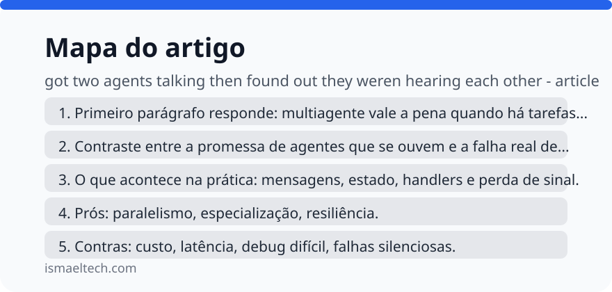
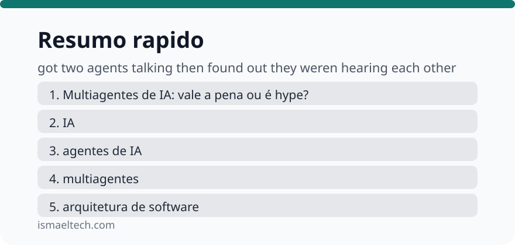

Dois agentes trocando mensagens parece automação pronta. Não é. Multiagente vale a pena quando o trabalho é independente, o contrato entre as partes é explícito e há ganho real de paralelismo. Por moda, quase nunca. A frase que resume o problema, "got two agents talking then found out they weren hearing each other", descreve o que acontece quando a conversa rola mas o contexto não.

A promessa é ótima no papel: um agente pesquisa, outro escreve, um terceiro revisa, e o resultado chega mais rápido. Na prática, cada agente carrega sua própria memória e seu próprio recorte do mundo. Se ninguém define quem escreve o estado, em que versão e o que acontece quando dois escrevem ao mesmo tempo, você não tem um time. Tem dois processos falando sozinhos com custo de API dobrado.

## Por que "got two agents talking then found out they weren hearing each other" acontece

<figure>

<figcaption>Etapas do artigo, na ordem em que o leitor vai encontrar cada ideia.</figcaption>
</figure>

O ponto de falha quase nunca é o modelo. É o encanamento. Mensagem é um evento. Estado é a verdade atual. Um agente que recebe o evento mas não atualiza a verdade continua agindo sobre uma foto antiga. O sinal some sem erro, sem stack trace, sem log vermelho.

Num pipeline com fila, o handler que só recebe o payload não tem como saber qual versão do estado originou aquele payload. Ele faz merge por sorte. Quando dois handlers escrevem a mesma chave, o último ganha e ninguém avisa.

```python
import asyncio

class Agente:
    def __init__(self, nome):
        self.nome = nome
        self.memoria = {}

async def registrar(self, chave, valor):
        await asyncio.sleep(0)
        self.memoria[chave] = valor

async def main():
    pesquisa = Agente("pesquisa")
    redacao = Agente("redacao")
    await asyncio.gather(
        pesquisa.registrar("sku", "A-100"),
        redacao.registrar("sku", "B-200"),
    )
    print(pesquisa.memoria["sku"])  # A-100
    print(redacao.memoria["sku"])  # B-200
    print(pesquisa.memoria is redacao.memoria)  # False

asyncio.run(main())
```

Os dois ouviram alguma coisa. Nenhum dos dois ouviu o outro. Corrigir isso exige contrato, não mais prompt.

```python
class Estado:
    def __init__(self):
        self.dados = {}
        self.versao = 0

def escrever(self, chave, valor, versao):
        if versao != self.versao:
            raise ValueError(f"conflito: esperava v{self.versao}, veio v{versao}")
        self.dados[chave] = valor
        self.versao += 1

estado = Estado()
estado.escrever("sku", "A-100", estado.versao)
estado.escrever("preco", 49.9, estado.versao)
```

Agora o segundo agente é obrigado a dizer em qual versão ele escreve. Se estiver desatualizado, estoura. Falha barulhenta é melhor que resposta errada silenciosa.

## Onde multiagente ganha

<figure>

<figcaption>Tema central e palavras-chave deste post.</figcaption>
</figure>

Paralelismo real aparece quando as tarefas não dependem umas das outras. Especialização ajuda quando cada prompt tem um objetivo estreito o bastante para ser avaliado sozinho. Resiliência aparece quando um worker morre e outro assume sem reprocessar tudo. Nesses três casos, a arquitetura paga o próprio custo.

## Onde ele cobra

Custo sobe porque cada passo extra é uma chamada, e cada chamada repete contexto. Latência sobe porque a coordenação entra no caminho crítico. Debug fica difícil porque a causa de um erro pode estar em duas mensagens atrás, em outro agente. E o pior: falhas silenciosas. O agente B segue confiante com dados do agente A de dez passos atrás, e o relatório final sai bonito e errado.

## Multiagente ou um agente com ferramentas?

Se o trabalho é uma sequência, comece com um agente e boas ferramentas. Um único loop com acesso a banco, busca e uma função de escrita resolve a maior parte dos casos com menos movimento. Um agente com ferramentas também erra, mas erra em um lugar só. O log é linear, a causa é local, e o diff do estado cabe na tela.

Multiagente entra quando há fronteira de contexto, não quando há vontade de organizar organograma. Compare pelo número de dependências entre tarefas: poucas, paralelizar; muitas, serializar.

## Checklist antes de adotar

- Cada agente tem um contrato de entrada e saída escrito, não implícito
- Existe uma fonte única de verdade para o estado
- A versão do estado viaja junto com a mensagem
- Você sabe explicar qual erro acontece quando um agente cai
- O ganho de tempo ou qualidade supera o custo extra de chamadas

Se não consegue marcar pelo menos os três primeiros, o desenho ainda não está pronto.

## Recomendação

Multiagente não é hype nem bala de prata. É uma ferramenta de coordenação com custo explícito. Use quando a independência entre tarefas for real e o contrato entre elas for chato de escrever, porque é essa chatice que segura o sistema de pé. Para todo o resto, um agente bem equipado com ferramentas e um bom log costuma ser mais barato, mais rápido de depurar e mais fácil de explicar para quem vai manter depois.

Se você decidir testar multiagente mesmo assim, vale fechar o experimento com critérios objetivos antes de colocar no caminho crítico.

## Takeaways práticos

- **Comece simples e meça a pressão real.** Antes de criar vários agentes, monte a versão com um agente único e ferramentas bem definidas. Se o gargalo for latência de uma API externa, contexto grande demais ou prompt ruim, dividir em agentes só adiciona coordenação em cima do problema original.
- **Contratos explícitos valem mais que prompts criativos.** Cada agente precisa ter entrada, saída, versão do estado e comportamento esperado em falha. Quando o contrato fica implícito no texto do prompt, o sistema pode parecer inteligente nos testes felizes e falhar em silêncio na produção.
- **Estado compartilhado exige uma fonte única de verdade.** Cache local por agente ajuda no desempenho, mas leitura e escrita de dados críticos precisam passar por um ponto central com regra clara de versão. Sem isso, dois agentes podem tomar decisões corretas olhando para estados diferentes.
- **Observabilidade não é enfeite.** IDs de execução, logs correlacionados, replay de mensagens e métricas por etapa são o que permitem entender por que o agente B tomou uma decisão ruim. Sem esse rastro, depurar multiagente vira adivinhação.
- **Compare custo total, não só qualidade da resposta.** Uma arquitetura multiagente pode gerar uma saída melhor em uma demo e ainda assim sair perdendo quando você soma custo por tarefa, latência ponta a ponta, taxa de erro silencioso e tempo de manutenção.

## Fontes

- [I got two AI agents talking, then I found out they weren't hearing each other](https://dev.to/kenielzep97/i-got-two-ai-agents-talking-then-i-found-out-they-werent-hearing-each-other-1fn6). Relato que originou esta pauta. A conversa entre agentes parece funcionar até o contexto deixar de circular, e é exatamente aí que a falha aparece.
- [Model Context Protocol: introduction](https://modelcontextprotocol.io/introduction). Especificação aberta para ligar modelos a ferramentas e fontes de dados. Mostra por que um contrato explícito de contexto vale mais que boa vontade entre agentes.
- [LangGraph](https://github.com/langchain-ai/langgraph). Referência prática para fluxos com estado explícito, grafos e retomada. Serve de exemplo de estado compartilhado tratado como parte do desenho, não como detalhe de log.
- [OpenAI Agents SDK](https://github.com/openai/openai-agents-python). Tool calling, handoffs e guardrails em pacote pequeno. Útil para comparar o custo de um agente com ferramentas contra uma malha de agentes coordenados.
- [ChatDev: Communicative Agents for Software Development](https://arxiv.org/abs/2307.07924). Paper sobre uma equipe de agentes com papéis divididos. Ajuda a separar o ganho real de especialização do custo de coordenação.
- [Generative Agents: Interactive Simulacra of Human Behavior](https://arxiv.org/abs/2304.03442). Estudo sobre memória e reflexão em agentes. Contexto compartilhado aparece como arquitetura de memória, não como detalhe de prompt.